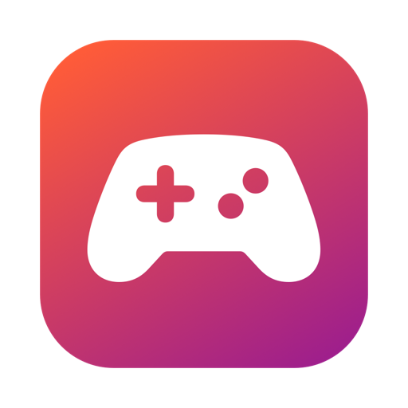

<p align="center"></p>

<h1 align="center">KickBack</h1>
<p align="center">Jogos e programas do Windows no seu Mac. Grátis e de código aberto.</p>
<p align="center"><a href="https://github.com/JGSimi/kickback/releases/latest/download/KickBack.dmg"><b>⬇ Baixar KickBack.dmg</b></a> · <a href="https://kickback-ten.vercel.app">Site</a></p>

---

O KickBack roda instaladores e jogos `.exe` do Windows no macOS. Ele usa o mesmo Wine de código
aberto que a CodeWeavers publica para o CrossOver 26.3, com as camadas gráficas DXVK, DXMT e
(opcionalmente) o D3DMetal da Apple, além de GStreamer para vídeos e SDL2 para controles.

## Instalar

1. Baixe o [`KickBack.dmg`](https://github.com/JGSimi/kickback/releases/latest/download/KickBack.dmg), abra e arraste o **KickBack** para **Aplicativos**.
2. Abra o app. Ele é assinado com Developer ID e notarizado pela Apple, então abre sem avisos.
3. Em Macs com Apple Silicon, o Rosetta 2 é necessário. O app avisa se faltar, e dá para instalar com
   `softwareupdate --install-rosetta --agree-to-license`.

**Requisitos:** macOS 13 ou mais novo e cerca de 3 GB livres, mais o espaço dos jogos. Testado em Apple Silicon (M1).

## Usar

1. Crie uma **garrafa**: um "PC Windows" isolado onde ficam os programas.
2. Arraste o instalador ou o jogo (`.exe`, `.msi`) para a janela.
3. Depois de instalado, o programa aparece em **Programas instalados**. É só clicar para jogar.

Em **Gráficos** você escolhe a tradução do DirectX:

| Opção | Para quê |
|---|---|
| Automático | D3DMetal se você importou o GPTK; senão DXMT |
| D3DMetal | DirectX 11 e 12 (precisa do Game Porting Toolkit da Apple, veja abaixo) |
| DXMT | DirectX 10/11 direto em Metal |
| DXVK | DirectX 9–11 via Vulkan (MoltenVK) |
| WineD3D | OpenGL, para jogos antigos |

**D3DMetal / DirectX 12:** a Apple não permite redistribuir o D3DMetal. Baixe o *Game Porting Toolkit*
em [developer.apple.com/games](https://developer.apple.com/games/) (conta gratuita), monte o `.dmg` e use
**Arquivo → Importar D3DMetal** no app.

Regras por jogo (backend e variáveis) ficam em `games.conf`.

## Limitações

- Jogos com anti-cheat em nível de kernel (Valorant, Fortnite etc.) não funcionam em nenhuma camada Wine.
- A base de regras por jogo começa vazia; o CrossOver tem uma base proprietária que não pode ser copiada.

## Como funciona

- `app/KickBack.swift`: interface SwiftUI que chama o `kb`.
- `kb`: monta o mesmo ambiente que o `cxstart` do CrossOver e executa o Wine.
- `cxcompatdb.c`: substituto aberto da peça fechada do CrossOver. O `ntdll.so` da CodeWeavers carrega esse
  módulo, e ele põe a pasta do backend gráfico na frente da busca de DLLs (`prepend_dll_path`).
- `build-runtime.sh`: compila todo o runtime a partir do código publicado pela CodeWeavers.
- `package.sh`: gera o `.app` relocável e o `.dmg`.

### Compilar do zero

Precisa do Xcode, Homebrew e `brew install mingw-w64 cmake meson ninja glslang bison autoconf automake pkg-config`.

```bash
mkdir -p build/src && curl -L https://media.codeweavers.com/pub/crossover/source/crossover-sources-26.3.0.tar.gz | tar -xz -C build/src
./build-runtime.sh   # cerca de 1 hora
./test.sh            # testes do kb
./package.sh         # dist/KickBack.dmg (ad-hoc)
# assinado e notarizado:
SIGN_ID="Developer ID Application: ..." NOTARY_PROFILE=kickback ./package.sh
```

## Licença

Código do KickBack: MIT. Componentes incluídos: veja [THIRD_PARTY_NOTICES.md](THIRD_PARTY_NOTICES.md).
KickBack não é afiliado à CodeWeavers nem à Apple. CrossOver é marca registrada da CodeWeavers, Inc.
